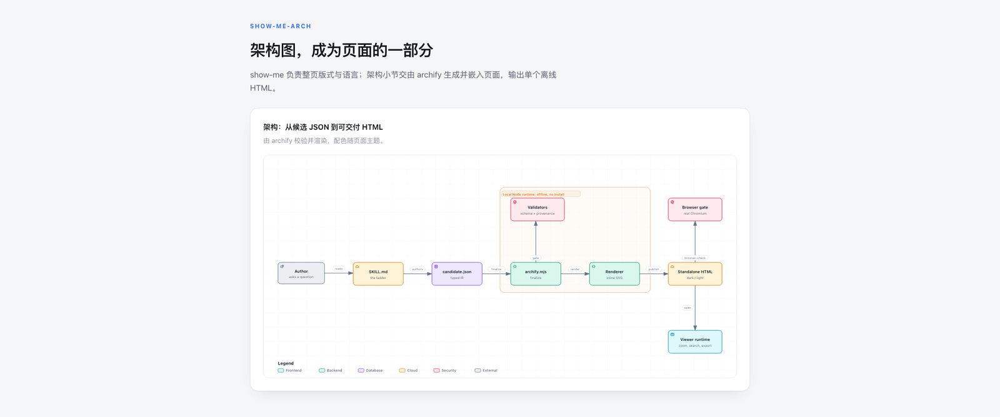

# show-me-arch

用**最小的视图**把当前话题讲清楚；当某一节需要系统结构时，交给内置的 [Archify](https://github.com/tt-a1i/archify) 引擎绘制，并**作为页面的一部分嵌入**。

读者拿到的是一份为这个问题、这个产品写出来的 HTML 页面，而不是一个看图工具。



> 上图由本技能生成：外层是手写的 show-me 页面，卡片中的架构图由 Archify 渲染并内嵌，配色随页面主题。

## 设计思路

### 先选最小视图（阶梯）

可视化不是「画一张图」，而是**选一个刚好够用的视图**。按下面的阶梯自上而下取第一个够用的：

| 层级 | 视图 | 适用 |
|------|------|------|
| 1 | 文本速写 | 伪代码、调用树、组件树、文件树 |
| 2 | `diff` | 重点是「改了什么」，且周围形状已存在 |
| 3 | Mermaid | 交互/控制流/数据流，文本树放不下但还不需要真图形 |
| 4 | show-me 页面 | 视觉布局、状态对比、或密到 Mermaid 画不清的概念 |
| 5 | 页面内嵌架构图 | 系统/流程结构：多个部分、带类型的关系、边界、状态 |

层级 5 才动用 Archify。触发条件是**系统或流程结构**，而不是「用户想要一张图」：

- 读者需要追踪谁和谁通信、顺序如何、数据与状态实际流向哪里
- 边界、归属、失败路径本身就是答案的一部分
- Mermaid 会因为节点和连线太多而变成一团乱麻

不适用于数值图表、仪表盘和数据可视化。

### 为什么不是直接用 Archify 的输出

Archify 的产物本身是一个完整的看图应用：自带工具栏、主题切换、搜索与导出。它有自己的视觉身份，不会跟随宿主产品的设计语言——直接把它当答案交付，得到的是一张 Archify 的图，而不是属于这个产品、这个问题的页面。

所以这里换个组合方式：仍然让 Archify 做它最擅长的事（校验语义、计算布局、渲染 SVG），但**只取其中的图形**，嵌进手写的页面里。

能做到这一点，是因为**图形本身几乎不含颜色**：SVG 里没有任何字面量色值，只有对一组 CSS 自定义属性的引用，由外层文档提供。它天生就是用来被宿主页面收养的。

## 支持的图类型

由 Archify 引擎提供，共 10 种：

| 类型 | 用途 |
|------|------|
| `architecture` | 组件、服务、云/安全边界、基础设施 |
| `workflow` | 流程、审批门、工具调用、runbook、CI/CD |
| `sequence` | API 调用链、请求生命周期、异步追踪 |
| `dataflow` | 管道、ETL/ELT、血缘、治理、消费方 |
| `lifecycle` | 状态迁移、重试、等待与终态 |
| `erd` | 表、字段、主/外/唯一键、基数 |
| `class` | 类、接口、成员、依赖与继承关系 |
| `tree` | 单亲包含：仓库/模块树、能力拆解 |
| `timeline` | 事件时间线：事故复盘、发布历史 |
| `waterfall` | 耗时分布：一次请求或 agent 运行的 span 嵌套 |

## 安装

```bash
git clone https://github.com/icrefin/skills.git
cd skills
```

安装到 Claude Code：

```bash
cp -r show-me-arch ~/.claude/skills/
```

安装到 DeepSeek Harness：

```bash
cp -r show-me-arch ~/.dsh/skills/
```

## 环境要求

- **Node.js >= 18**（渲染引擎需要）
- **无第三方依赖**：引擎只用 Node 内置模块，克隆即可用，不需要 `npm install`
- **离线可用**：不发起任何网络请求
- 技能自带 Archify 引擎（MIT），无需另外安装

自检：

```bash
node show-me-arch/bin/archify.mjs doctor
```

## 使用方法

在对话中直接描述需求即可，例如：

```
画一张这张系统的架构图
把这个仓库的模块结构画出来
帮我梳理一下这个请求的调用链
生成一份带架构图的 HTML 报告
```

### 生成架构图

按 Archify 的流程写候选 JSON，然后跑 `finalize`：

```bash
node show-me-arch/bin/archify.mjs finalize architecture \
  .archify/architecture-my-system/candidate.json \
  .archify/architecture-my-system/diagram.html \
  --quality showcase --json
```

四个门（`validate` → `deliver` → `check` → `browser-check`）全过，图形才可信。非零退出**永远是失败**，读诊断信息、改候选、重跑同一条命令。

### 嵌入到页面

不要手贴整段 `<svg>`——它自身只有节点描边，文字、连线、标签、图例都依赖外层样式表。用嵌入脚本：

```bash
# 单张图
node show-me-arch/scripts/embed-diagram.mjs diagram.html --out fig-1.html --theme light

# 一页多图：一份共享样式表 + 每图一个片段
node show-me-arch/scripts/embed-diagram.mjs a.html b.html --out-dir <folder> --theme light
# → shared.html（整页只引一次）, fig-1.html, fig-2.html
```

脚本会：取出 SVG → 连同它**真正依赖**的那部分样式一起提取 → 限定作用域（不污染页面）→ 给 id 加命名空间（一页可放多张图）。

可选参数：

| 参数 | 说明 |
|------|------|
| `--theme light\|dark` | 图形主题，跟随宿主页面 |
| `--preset classic\|signal-flow\|blueprint\|editorial` | Archify 内置视觉预设 |
| `--palette <file.json>` | 用 `{"--bg":"#fff"}` 之类的变量覆盖，让图形贴合页面设计令牌 |
| `--scope <id>` | 手动指定 id 命名空间前缀 |

> **注意**：样式是按图形类型挑选的，不同图类型需要的规则并不相同。一页里放了架构图又放时序图，却只用其中一张的样式表，另一张会画在黑底上。多图页面请用 `--out-dir` 模式取并集。

### 在真实浏览器里核对

`finalize` 的凭证只证明**图形本身**没问题，不证明你的页面排版没问题：

```bash
node show-me-arch/bin/archify.mjs visual-check page.html --out-dir vc
```

会在 1440×900 与 2048×1320 两个视口、深浅两个主题下截图。

> 文档型页面会报 `viewer/viewport-overflow`，可以忽略——那是图产物（单图自适应）的容纳策略，而文档本来就该能滚动。看截图，不要看状态。

## 文件结构

```
show-me-arch/
├── SKILL.md              # 技能定义（模型读取的指令）
├── README.md             # 本文档
├── preview.png           # 预览图
├── bin/                  # Archify 命令行（finalize / render / visual-check / doctor …）
├── renderers/            # 10 种图的渲染器
├── schemas/              # 10 种图的 JSON Schema
├── examples/             # 各类图的候选 JSON 示例（形状参考）
├── references/           # 按需加载的深入文档（布局修复、交付契约等）
├── scripts/
│   ├── embed-diagram.mjs # ★ 把图形取出来嵌进你的页面
│   └── ...               # 引擎自带脚本
├── assets/               # 渲染模板与字体
├── locales/              # 图形内文案的多语言
├── recipes/              # 场景推荐（archify guide）
├── delta/                # 架构图对比
├── migrations/           # 旧版本 JSON 迁移
└── brand-marks/          # 品牌图标
```

## 第三方与许可

本技能**打包**了 [Archify](https://github.com/tt-a1i/archify) 引擎（作者 tt-a1i，MIT 许可），以便克隆即可运行。相关文件：

- [`LICENSE`](./LICENSE) — Archify 的 MIT 许可
- [`THIRD_PARTY_NOTICES.md`](./THIRD_PARTY_NOTICES.md) — 第三方组件与品牌素材声明

页面版式、阶梯设计、嵌入脚本与本文档由本技能提供。

Archify 另有一个独立的 DSH 插件（`@tt-a1i/archify-dsh`）。本技能使用自己打包的引擎副本，两者互不依赖，也不会自动同步。

## English

**show-me-arch** explains a topic visually, picking the *smallest* view that makes the point — ASCII sketches (pseudocode, call trees, component trees, file trees), diffs, Mermaid, or a bespoke HTML page.

When that page needs a system or process map, the bundled [Archify](https://github.com/tt-a1i/archify) engine renders it and `scripts/embed-diagram.mjs` lifts the SVG plus exactly the styling it depends on — scoped so it cannot leak, id-namespaced so several diagrams can share a page — and drops it into your page.

The result is a single offline HTML page written for *this* product and *this* question, not a diagram viewer.

```bash
node show-me-arch/bin/archify.mjs finalize architecture candidate.json diagram.html --quality showcase --json
node show-me-arch/scripts/embed-diagram.mjs diagram.html --out fig-1.html --theme light
```

Requires Node.js >= 18. No dependencies, no install step, no network access.

## 更新日志

### v1.0.0 (2026-10-17)
- 初始版本
- 五级可视化阶梯：文本速写 → diff → Mermaid → show-me 页面 → 内嵌架构图
- 内置 Archify 引擎，支持 10 种图类型
- `embed-diagram.mjs`：图形提取、样式作用域限定、id 命名空间、单图/多图模式
- 支持主题、视觉预设与调色板覆盖

## 许可证

MIT License