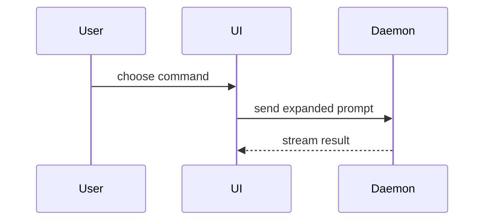

# show-me-arch

Explain the current topic visually. Skip the preamble, keep prose brief, and pick the **smallest view that makes the key point**. Escalate to a heavier view only when a lighter one cannot carry the subject.

## The ladder

Work down this list and stop at the first rung that carries the point.

### 1. Inline text views

Show logic or an algorithm as pseudocode:

```text
on(save)
  if content is unchanged
    return cached result
  write new content
  return fresh result
```

Show runtime control flow as a call tree:

```text
submitForm
  createSession
    persistPrompt
    launchAgent
  navigateToSession
```

Show UI structure as a component tree, including state and module boundaries that matter:

```tsx
<SessionPage> (apps/example/src/routes/session.tsx)
  useSessionEvents()
  <SessionToolbar>
    <RunSkillButton> (packages/ui)
```

Show file responsibility or a broad refactor as a shallow file tree:

```text
src/
├── commands/       # parses user actions
├── sessions/       # owns session state
└── transport/      # sends API requests
```

### 2. Diffs

Use `diff` when the point is what changes and the surrounding shape already exists. Match the diff shape to the topic.

For a component change:

```diff
 <SessionPage>
   useSessionEvents()
   <SessionToolbar>
+    <RunSkillButton />
   <SessionTimeline>
+    <SkillResultCard />
```

For a file-layout change:

```diff
 src/
 ├── commands/
+│   └── show-me.ts       # expands the slash command
 ├── sessions/
-└── transport.ts
+└── transport/
+    ├── client.ts
+    └── stream.ts
```

For a call-tree or call-stack change:

```diff
 submitForm
   createSession
     persistPrompt
+    expandSkillMention
     launchAgent
-  navigateToSession
+  navigateToSession
+    subscribeToEvents
```

For a state or control-flow change:

```diff
 on(save)
-  write content
+  if content is unchanged
+    return cached result
+  write new content
+  invalidate cache
```

Show the whole block when most of it is new, when omitted context would hide ownership or order, or when the user needs a copyable target shape:

```ts
function expandSkill(command: string): string {
  const skillName = command.slice(1)
  return `use the ${skillName} skill`
}
```

### 3. Mermaid

Use Mermaid for component interaction, control flow, or data flow that is a little too wide for a text tree but does not yet need a real artifact:



### 4. A show-me page

For a visual UI, layout, state comparison, or a concept too dense for Mermaid, write **one focused HTML file** — a diagram, an infographic, or a short slide deck, whichever fits the point. This page is the deliverable. Match the product's colors, type, spacing, and components; use real labels and data; support desktop and mobile.

### 5. Architecture inside that page

When the page needs a **system or process map** — many parts, typed relationships, boundaries, ownership, or states — do not hand-draw it, and do not hand the user a diagram viewer instead of a page. Generate the section with **Archify** and embed it into your page as part of it.

Use an embedded diagram when:

- the reader must trace who talks to whom, in what order, or where data and state actually go
- boundaries, ownership, or failure paths are part of the answer
- Mermaid would need so many nodes and edges that it turns to spaghetti

Do not use it for numeric charts, dashboards, or data plots.

## Generating an architecture section

The page is yours; only the architecture section comes from the engine. The rendering engine is bundled in this skill's directory. Call it **Archify** (MIT, [tt-a1i/archify](https://github.com/tt-a1i/archify)).

Let `<skill-dir>` be this skill's base directory, given when the skill loads. Input and output paths resolve from your **working directory**, not from the skill directory.

It needs Node.js >= 18. There is no install step, no dependency, and no network access.

```bash
node <skill-dir>/bin/archify.mjs doctor                    # setup check
node <skill-dir>/bin/archify.mjs guide "<scenario>" --json # type recommendation
```

### Workflow

1. **Pick the type** from the router below. When ambiguous, run `guide`.
2. **Read for shape, not facts.** Read `<skill-dir>/references/authoring-defaults.md` and the type's example, then the mode schema and `<skill-dir>/schemas/common.schema.json`. Read the schema definition before using any field, enum, or constrained text you have not used before. Examples teach shape — use fresh IDs, wording, and layout.
3. **Write the complete candidate** directly, with no preliminary validation and no coordinates planned in prose. Put each request in its own folder `.archify/<type>-<slug>-<YYYYMMDD-HHMMSS>/` in the working directory, keeping `candidate.json` and the rendered `<slug>.html` together, with `meta.output` set to that HTML path. Reuse the folder for repair reruns. A later request gets a new folder, so earlier versions stay intact. Set `meta.quality_profile` to `"showcase"` unless the user asks for dense `"standard"`.
4. **Finalize.** This is the only command you need for a first draft:

```bash
node <skill-dir>/bin/archify.mjs finalize <type> <folder>/candidate.json <folder>/<slug>.html --quality showcase --json
```

A passing receipt proves `validate`, `deliver`, strict `check`, and real-browser `browser-check` all passed. Keep the candidate unchanged while the command runs.

5. **A non-zero exit is never success.** Read the compact stdout or `evidence.summaryReceipt`, fix the failed gate, and rerun the *same* finalize command. Preserve the requested meaning. Edit the connected neighborhood rather than the whole diagram. Read `<skill-dir>/references/delivery-contract.md` for failed-gate repair and its repair limit; `<skill-dir>/references/architecture-layout-repair.md` for tangled architecture routes; `<skill-dir>/references/authoring-contract.md` for measured field or geometry failures.

For a real codebase, read `<skill-dir>/references/repository-authoring.md` while tracing the behavior, then add `--repo-root <repo-root>` to the first finalize command and include source evidence in the first draft.

### Embedding the diagram into your page

The rendered `<slug>.html` is a full viewer app. Never hand that to the reader as the answer, and never paste its `<svg>` alone — the SVG carries almost no color of its own and expects a surrounding document to supply the palette. Use the embedding script, which lifts the SVG plus exactly the styling it depends on, scopes that styling so it cannot leak into your page, and namespaces the SVG's ids so several diagrams can share one page.

One diagram:

```bash
node <skill-dir>/scripts/embed-diagram.mjs <folder>/<slug>.html --out <folder>/fig-1.html --theme light
```

Several diagrams on one page — emit one stylesheet covering all of them, then a figure for each:

```bash
node <skill-dir>/scripts/embed-diagram.mjs a.html b.html --out-dir <folder> --theme light
# → shared.html (include once), fig-1.html, fig-2.html
```

Then paste `shared.html` once and each `fig-*.html` into your page where the architecture section belongs.

Pass `--palette <file.json>` with `{"--bg": "...", "--text": "..."}` to retarget the diagram to your page's design tokens, so the section reads as part of the page rather than a pasted screenshot.

**Never reuse one diagram's stylesheet for a different diagram type.** The styling vocabulary is type-specific: a sequence diagram that inherits an architecture diagram's stylesheet renders on a black canvas. Let the script's multi-diagram mode compute the union.

### Type router

| Type | Use for | Schema | Example |
|---|---|---|---|
| `architecture` | Components, services, cloud/security boundaries, infrastructure; what something is made of | `schemas/architecture.schema.json` | `web-app.architecture.json`; deployment repos: `production-deployment.architecture.json` |
| `workflow` | Processes, approval gates, tool calls, runbooks, CI/CD | `schemas/workflow.schema.json` | `agent-tool-call.workflow.json` |
| `sequence` | API call chains, request lifecycles, async traces, returns | `schemas/sequence.schema.json` | `cache-miss-request.sequence.json` |
| `dataflow` | Pipelines, ETL/ELT, lineage, governance, consumers | `schemas/dataflow.schema.json` | `product-analytics.dataflow.json` |
| `lifecycle` | State and status transitions, retries, waiting and terminal states | `schemas/lifecycle.schema.json` | `agent-run.lifecycle.json` |
| `erd` | Tables, attributes, primary/foreign/unique keys, cardinality | `schemas/erd.schema.json` | `orders.erd.json` |
| `class` | Classes, interfaces, members, and dependency/inheritance relationships | `schemas/class.schema.json` | `payments.class.json` |
| `tree` | Single-parent containment: repository/module trees, capability breakdowns | `schemas/tree.schema.json` | `payment-platform.tree.json` |
| `timeline` | When things happened: incident reviews, release histories, timestamped events | `schemas/timeline.schema.json` | `payment-incident.timeline.json` |
| `waterfall` | Where the time went: span durations, overlap, nesting on one time axis | `schemas/waterfall.schema.json` | `checkout-request.waterfall.json` |

Schemas are at `<skill-dir>/schemas/`, examples at `<skill-dir>/examples/`. Mermaid input is read for topology and meaning, then re-authored fresh — never mechanically re-styled. See the mapping in `<skill-dir>/references/authoring-defaults.md`.

For an everyday subject with steps, parts, relationships, or states — a leave plan, a renting conversation, an application, a money flow — keep the same diagram modes and vocabulary, name things for the reader, and ask for missing personal facts instead of inventing dates, amounts, or rules.

### Delivery

For an explicit visual review, use `--out-dir <folder>/visual-check` and read `<skill-dir>/references/delivery-contract.md` for optional capture evidence. When a passing architecture receipt reports `visualReviewRecommendation.signals.resolvedCrossovers`, copy the candidate aside and make one edit that changes only node positions and sizes, then rerun finalize once with `--out-dir <folder>/review-2`. Do not start a second placement round.

Live motion is on by default; omit `meta.animation`. Read `<skill-dir>/references/viewer-runtime.md` only when the user asks for motion, deep links, presentation, search/focus, share cards, or exports.

### Output

- Lead with a clickable Markdown link to the **page you wrote**: a descriptive title, not the file name, with its absolute path wrapped in `<...>` when it contains spaces.
- When the user wants to understand a system or codebase rather than draw a described subject, add one or two sentences with the key takeaway. Skip sentences that only restate what the page obviously shows.
- State anything that changes how the architecture section should be read: the abstraction level or deliberately omitted parts, illustrative rather than measured values, or missing source evidence.
- Do not recap commands, repair rounds, hashes, or quality profiles.
- Offer the viewer HTML as a separate link only when the reader wants to explore the diagram interactively.

Example: `Created [Checkout request timing](/abs/path/checkout-timing.html). Durations are illustrative, not measured.`

### Verifying the composed page

The `finalize` receipt proves the *diagram* is sound; it says nothing about your page. To see the composition actually render, capture it in a real browser:

```bash
node <skill-dir>/bin/archify.mjs visual-check <folder>/page.html --out-dir <folder>/vc
```

It writes PNGs at two viewports and both themes. Read them before claiming the page looks right.

Expect `viewer/viewport-overflow` on a document page and ignore that verdict — it is the diagram-artifact containment policy, and a scrolling document is supposed to scroll. Judge the screenshots, not the status.

### No shell access

Hand-place architecture SVG into `<skill-dir>/assets/template.html`, using the CSS semantic classes rather than inline colors, and follow the visual review contract in `<skill-dir>/references/delivery-contract.md`.

## guidance

Place each visual next to the short text it supports. Keep only the calls, files, props, states, and boundaries needed to answer the user's current question or resolve the current discussion point.

You may use one rung, you may use several, it is unlikely you will use all of them. Use your judgement and don't overwhelm the user.

The page is the deliverable. A reader should be able to tell it was written for this product and this question, not assembled from a template — that is the whole point of embedding the architecture section rather than linking a viewer. Then open it for the user.